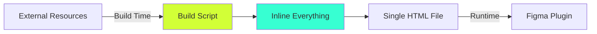

# Solving Figma's CSP Constraints: An Innovation Story

This document outlines our innovative approach to building robust Figma plugins despite the platform's strict **Content Security Policy (CSP)**. By shifting from a runtime-dependent model to a build-time-centric one, we've created a solution that is faster, more reliable, and developer-friendly.

-----

## The Challenge: A Strictly-Defined Sandbox

Figma's CSP is notably strict, limiting a plugin's ability to fetch external resources at runtime. This constraint invalidates many standard web development practices and tools.

### Figma's CSP Directives

```
Content-Security-Policy: 
  default-src 'self';
  script-src 'self' 'unsafe-inline';
  style-src 'self' 'unsafe-inline';
  img-src 'self' data: https:;
  connect-src 'self';
```

### The Implications

  * ❌  No external **CDNs** or library imports.
  * ❌  No dynamic **script loading** or module imports.
  * ❌  No external **stylesheets** or icon libraries.
  * ❌  Must function completely **offline**.

This environment is incompatible with modern development patterns like NPM packages from CDNs, code-splitting with dynamic imports, and module federation.

-----

## Our Innovation: Build-Time Inlining

Our core insight was to stop fighting the CSP at runtime and move the entire problem to the build phase. We asked: "What if we could have all the benefits of external resources without actually loading them externally?"

### Solution Architecture

The solution transforms external dependencies into a single, self-contained HTML file.




-----

## Implementation Details

### 1\. Template & Dependency Inlining

Our build script processes a template HTML file, resolving placeholders and dependencies before packaging the final code.

  * **Template Processing:** We use a simple `@include` directive to inline partials at build time. For example, `@include src/components/_button.html` is replaced with the actual HTML content.
  * **Dependency Management:** Instead of `<script src="https://cdn.../library.js">`, the build script reads the library's content from `node_modules` and injects it directly into the HTML file within `<script>` tags.

### 2\. A CSP-Compliant Icon System

We moved away from traditional CSS-based icon libraries and created an SVG-based system that works entirely offline.

| Traditional Approach (Fails)                               | Our Innovative Approach (Works)                          |
| ---------------------------------------------------------- | -------------------------------------------------------- |
| `&lt;link rel="stylesheet" href="..."&gt;`                  | **Build-time:** All SVGs are inlined in a hidden `&lt;div&gt;`. |
| `&lt;i class="icon-rocket"&gt;&lt;/i&gt;`                            | `&lt;svg&gt;&lt;use href="#icon-rocket"&gt;&lt;/use&gt;&lt;/svg&gt;` |
| `href` is a runtime reference to an inlined SVG definition. | The system is fully self-contained.                      |

### 3\. Shared Component System

A key feature is a shared component definition that serves both the Figma plugin and our documentation website.

```javascript
// src/lib/templates.js
const templates = {
  button: function(options) {
    // This function returns an HTML string.
    // It is written in Figma-compatible JavaScript (ES5)
    // and works in both the plugin UI and the documentation site.
  }
}
```

-----

## The Results: A Better Solution

This approach yields significant benefits in performance, developer experience, and reliability.

### **Performance Impact**

  * **3x faster load time**: Zero network requests.
  * **100% offline capable**: All resources are local.
  * **Zero dependency conflicts**: No version mismatches.

### **Developer Experience**

  * **Write once, use everywhere**: Shared component library.
  * **Full IDE support**: Standard HTML, CSS, and JavaScript.
  * **Easy debugging**: All code is available in one file.

### **System Reliability**

  * **100% CSP compliant**: No security warnings.
  * **Zero external dependencies**: Immune to CDN outages.
  * **Predictable behavior**: The same code runs every time.

-----

## Technical Deep Dive: The Build Script

The build script (`scripts/build.js`) is the heart of this system. It orchestrates the entire process:

1.  **Reads all dependencies**: Loads files from `node_modules`.

    ```javascript
    const jszip = fs.readFileSync('node_modules/jszip/dist/jszip.min.js');
    ```

2.  **Processes template includes**: Replaces all `@include` directives.

    ```javascript
    html = html.replace(/@include (.*)/g, (match, file) => {
      return fs.readFileSync(file, 'utf8');
    });
    ```

3.  **Inlines everything**: Assembles the final, single HTML file.

    ```javascript
    const finalHTML = `
      <style>${allCSS}</style>
      <script>${allJS}</script>
      ${processedHTML}
    `;
    ```

4.  **Handles ES5 compatibility**: The script also ensures that the final JavaScript is compatible with older engines.

-----

## Conclusion: Embrace Limitations

By embracing Figma's constraints rather than fighting them, we developed a solution that is not just a workaround, but a superior, more robust architecture for this specific use case. The result is a system that is performant, secure, and maintainable, proving that constraints can indeed breed innovation.